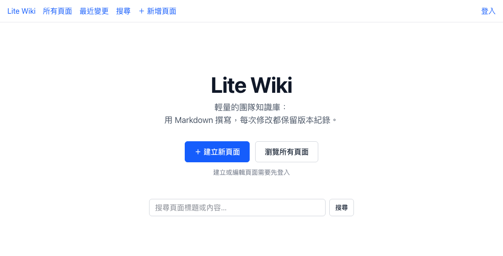
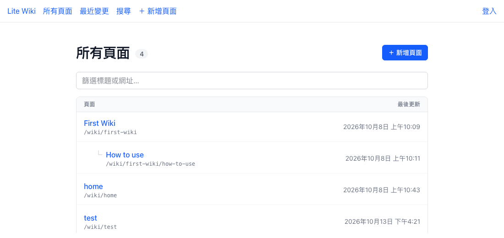

# Lite Wiki

輕量、可自架的團隊知識庫。用 Markdown 撰寫，每次修改都保留版本紀錄。

> **狀態：Alpha（v0.1.0）**。核心功能已可使用，適合小團隊自架試用；尚未建議用於正式環境，請參考[已知限制](#已知限制)。





## 功能

- **Markdown 編輯**：所見即所得編輯器（MDXEditor），也可切換原始碼模式，或與上一版比較
- **圖片上傳**：從工具列、貼上或拖曳插入圖片（PNG、JPEG、GIF、WebP，單張 5MB 以內），同一張圖只存一份
- **版本紀錄**：每次儲存都是新版本，可瀏覽任一歷史版本、比較兩個版本
- **階層頁面**：用網址表示上下層（例如 `/wiki/docs/intro`），自動產生麵包屑
- **搜尋**：依關鍵字搜尋標題與內容
- **最近變更**：所有頁面的修改紀錄
- **同時編輯保護**：別人先儲存時會提示，不會直接覆蓋
- **帳號與角色**：瀏覽公開；檢視者只能瀏覽，編輯者可以建立與編輯頁面，管理員另外可以刪除、還原頁面與管理帳號
- **刪除與還原**：刪除的頁面保留所有版本，管理員可以在「已刪除的頁面」還原

## 技術

| | |
|---|---|
| 前端 | React 19、TanStack Router、Tailwind CSS、MDXEditor、react-markdown |
| 後端 | Hono（Node.js）、`pg`（直接寫 SQL，不使用 ORM） |
| 資料庫 | PostgreSQL |

## 快速開始

### 需要的環境

- Node.js 24 以上
- PostgreSQL（沒有的話可以用專案附的 Docker Compose 啟動）

### 1. 下載並安裝套件

```bash
git clone https://github.com/open-tw/lite-wiki.git
cd lite-wiki
(cd server && npm install)
(cd app && npm install)
```

### 2. 準備資料庫

使用 Docker 啟動 PostgreSQL（帳號密碼與 `.env.example` 的預設值一致）：

```bash
cd server
docker compose up -d
```

已經有自己的 PostgreSQL 的話，先建立一個資料庫（例如 `lite_wiki`），跳過這一步。

### 3. 設定環境變數

```bash
cd server
cp .env.example .env
```

| 變數 | 說明 | 預設值 |
|---|---|---|
| `PG_HOST` | 資料庫主機 | `localhost` |
| `PG_PORT` | 資料庫連接埠 | `5432` |
| `PG_USER` | 資料庫帳號 | `postgres` |
| `PG_PASSWORD` | 資料庫密碼（本機 trust 驗證可留空） | `postgres` |
| `PG_DATABASE` | 資料庫名稱 | `lite_wiki` |
| `PORT` | 後端 API 的連接埠 | `3001` |
| `UPLOAD_DIR` | 上傳圖片的存放目錄（相對路徑以 `server/` 為準） | `uploads` |

### 4. 建立資料表與帳號

```bash
cd server
npm run db:init
npm run user:create -- admin <你的密碼（至少 8 個字）>
```

資料庫還沒有帳號時，這個指令建立的是管理員。之後的帳號由管理員在「帳號管理」頁面建立，不開放註冊。

從舊版升級時重新執行 `npm run db:init` 即可補上新的欄位；既有帳號會成為編輯者，其中最早建立的帳號會成為管理員。

### 5. 啟動

開兩個終端機：

```bash
cd server && npm run dev   # 後端 http://localhost:3001
```

```bash
cd app && npm run dev      # 前端 http://localhost:3000
```

打開 <http://localhost:3000>，用剛才建立的帳號登入，就可以開始建立頁面。

## 專案結構

```
lite-wiki/
├── app/                 前端（Vite + React）
│   └── src/
│       ├── routes/      頁面路由（檔案即路由）
│       ├── components/  共用元件
│       └── lib/         API 呼叫、登入狀態、工具函式
└── server/              後端（Hono）
    ├── src/
    │   ├── routes/      API 路由
    │   └── scripts/     db:init、user:create
    ├── sql/init.sql     資料表定義
    └── docs/api.md      API 規格與前端對應
```

## 部署

- 後端：`cd server && npm run build && npm start`
- 前端：`cd app && npm run build`，將 `app/dist/` 作為靜態檔案提供
- **前端與 `/api` 必須在同一個網域**（登入使用 cookie）。例如用 Nginx 或 Caddy 提供 `app/dist/`，並把 `/api` 轉給後端；未符合的路徑要回傳 `index.html`
- 正式環境請設定 `NODE_ENV=production`，session cookie 才會加上 `Secure`（需要 HTTPS）
- 上傳的圖片存在 `UPLOAD_DIR`，不在資料庫裡。用容器部署時請把這個目錄掛載成 volume，備份時也要和資料庫一起備份，否則重新部署後圖片會遺失
- 反向代理若有限制請求大小（例如 Nginx 預設 `client_max_body_size 1m`），請調到 6MB 以上，否則較大的圖片會在到達後端前被擋下

## 已知限制

- 版本比較目前只是左右並排顯示原文，尚未標示差異
- 登入沒有限制嘗試次數；過期的 session 不會自動清除
- 權限只分全站角色，還不能針對個別頁面設定；也還不能關閉匿名瀏覽
- 尚未有自動化測試與 CI
- 尚未支援暗色模式

歡迎開 issue 或 PR。

## 授權

[MIT](LICENSE)
